<picture>
  <source media="(prefers-color-scheme: dark)" srcset="assets/terminal.svg">
  <source media="(prefers-color-scheme: light)" srcset="assets/terminal.svg">
  
</picture>

## SYSTEM / ABOUT

Creative developer working across software, interfaces, 3D and digital experiences. CTRLZ is the working identity behind this profile: clarity before complexity, with public notes shared only when ready.

## ACTIVE PROJECT / CW3

**CTRLZ Warehouse 3D**<br>
Warehouse Management System / Digital Twin<br>
`STATUS: IN DEVELOPMENT`  `ACCESS: PRIVATE`

CW3 is presented here through public development status only. No private source, internal architecture or confidential operational data is published.

<!-- CW3_TERMINAL_LOG:START -->
### CW3 / EXECUTION LOG

```text
$ cw3 status
STATUS   IN DEVELOPMENT
PHASE    NOT PUBLISHED
UPDATED  Not publicly recorded
ACCESS   PRIVATE / PUBLIC STATUS ONLY
```

**Latest public change:** No public daily report has been recorded yet.<br>
**Next public objective:** No public next step recorded.<br>
**Validated milestones:** None publicly recorded

<picture><source media="(prefers-color-scheme: dark)" srcset="assets/cw3-terminal-dark.svg"><source media="(prefers-color-scheme: light)" srcset="assets/cw3-terminal-light.svg"></picture>

| Date | Public report |
| --- | --- |
| - | No public report recorded yet. |
<!-- CW3_TERMINAL_LOG:END -->

## CONTRIBUTION SIGNAL

<picture>
  <source media="(prefers-reduced-motion: reduce)" srcset="assets/snake-static.svg">
  
</picture>

Generated from the public contribution graph with [Platane/snk](https://github.com/Platane/snk).

<p align="center"><a href="https://github.com/youssef-hammounaicha">GitHub</a> / CTRLZ / DIGITAL EXPERIENCES</p>
