<picture>
  <source media="(max-width: 600px)" srcset="assets/header-mobile.svg">
  
</picture>

<picture>
  <source media="(max-width: 600px)" srcset="assets/terminal-mobile.svg">
  
</picture>

## Project signal monitor

<picture>
  <source media="(max-width: 600px)" srcset="assets/project-monitor-mobile.svg">
  
</picture>

## Technical stack

**Frontend** — TypeScript, React, Next.js, Tailwind CSS  
**3D & motion** — Three.js, React Three Fiber, Blender, Motion  
**Backend** — Python, FastAPI, PostgreSQL  
**Workflow** — Git, GitHub, AI-assisted development

## Contribution signal

<picture>
  <source media="(prefers-reduced-motion: reduce)" srcset="assets/snake-static.svg">
  
</picture>

Generated daily from the public contribution graph with [Platane/snk](https://github.com/Platane/snk). This is an activity view, not a measure of work held in private projects.

## Connect

Based in **Morocco**, working worldwide. Open to creative collaborations, digital projects and new opportunities.

[GitHub](https://github.com/youssef-hammounaicha)

CTRLZ / DIGITAL EXPERIENCES / 2026

Original portfolio artwork & credits

Original portfolio artwork preserved. Custom SVG identity and monitoring assets created for this profile. Visual language inspired by [Profile Signal Kit](https://github.com/saroo98/profile-signal-kit); no template source or assets copied.

