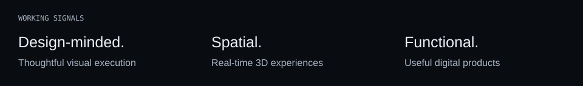

<picture>
  <source media="(max-width: 600px)" srcset="assets/header-mobile.svg">
  
</picture>

# Youssef Hammounaicha

**Creative developer working at the intersection of software, design and real-time 3D.**

I build digital products, interactive websites and spatial experiences, with an emphasis on clarity, usability and thoughtful visual execution.

[Selected work](#selected-work) · [Toolbox](#toolbox) · [Connect](#connect)

<picture>
  <source media="(max-width: 600px)" srcset="assets/terminal-mobile.svg">
  
</picture>

## Selected work

### CW3 / Warehouse Digital Twin

A warehouse management system connecting operational workflows with interactive 3D visualization.

`Next.js` · `React` · `Three.js` · `FastAPI` · `PostgreSQL`

**In development · Private project.** Source code remains private.

### ATELIER 01 / Architectural Web Experience

An exploration of architecture, materials, motion and spatial storytelling through the web.

`Next.js` · `React Three Fiber` · `TypeScript` · `Motion`

**Experimental project.**

### 3D Lab / Interactive Environments

Experiments in real-time 3D, visual storytelling and immersive digital interfaces.

`Three.js` · `Blender` · `WebGL`

**Research & development.**

## Working principles

Clarity over complexity. Function before decoration. Details make the difference.

<picture>
  <source media="(max-width: 600px)" srcset="assets/signals-mobile.svg">
  
</picture>

## Toolbox

**Frontend** — TypeScript, React, Next.js, Tailwind CSS 
**3D & motion** — Three.js, React Three Fiber, Blender, Motion 
**Backend** — Python, FastAPI, PostgreSQL 
**Workflow** — Git, GitHub, AI-assisted development

## Contribution trail

<picture>
  <source media="(prefers-reduced-motion: reduce)" srcset="assets/snake-static.svg">
  
</picture>

Generated daily from GitHub contributions with [Platane/snk](https://github.com/Platane/snk). This graph is an activity view, not a measure of the work held in private projects.

## Connect

Based in **Morocco**, working worldwide. Open to creative collaborations, digital projects and new opportunities.

[Find me on GitHub](https://github.com/youssef-hammounaicha)

Original portfolio artwork & credits

Original portfolio artwork preserved. Custom SVG identity and terminal assets created for this profile. Self-contained panels and signals inspired by [Profile Signal Kit](https://github.com/saroo98/profile-signal-kit); no template source or assets copied.

