<picture>
  <source media="(prefers-color-scheme: dark)" srcset="assets/hero-dark.svg">
  <source media="(prefers-color-scheme: light)" srcset="assets/hero-light.svg">
  
</picture>

## Mission-critical systems

| System | Role | Purpose |
| --- | --- | --- |
| CW3 | Warehouse Management / Digital Twin | STATUS: IN DEVELOPMENT · ACCESS: PRIVATE |

## Execution deck

<!-- CW3_EXECUTION_DECK:START -->
<picture><source media="(prefers-color-scheme: dark)" srcset="assets/cw3-execution-dark.svg"><source media="(prefers-color-scheme: light)" srcset="assets/cw3-execution-light.svg"></picture>

**Last public update:** Not publicly recorded  
**Latest public change:** No public daily report has been recorded yet.
<!-- CW3_EXECUTION_DECK:END -->

## Contribution signal

<picture>
  <source media="(prefers-reduced-motion: reduce)" srcset="assets/snake-static.svg">
  
</picture>

Generated from the public contribution graph with [Platane/snk](https://github.com/Platane/snk).

<a href="https://github.com/youssef-hammounaicha">GitHub</a> · CTRLZ / DIGITAL EXPERIENCES

